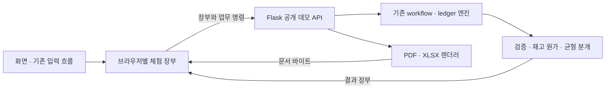

# 구조와 설계

## 요청 흐름

| 구성 | 역할 |
| --- | --- |
| `app/app.js`, `app/erp.js` | 라우팅, 입력, 실제 업무 화면 |
| `app/portfolio.js`, `app/portfolio.css` | 공개 대시보드, 시각 스타일, 데모 투어 |
| `app/demo-store.js` | 브라우저 저장, 충돌 확인, 다운로드, 초기화 |
| `app/domain.js`, `app/erp-domain.js` | 기존 JavaScript 금액·미수금·업무 계산 |
| `demo_cloud.py`, `demo_seed.py` | 무상태 데모 API, 기존 명령으로 만든 가상 장부 |
| `workflow.py`, `ledger.py`, `ledger_replay.py` | 견적·주문, 전표·결제·입출고, 원가 재계산 |
| `erp_documents.py`, `quote_pdf.py` | 내부 원가를 제거한 고객용 문서 |
| `cloud.py`, `private_storage.py` | 보존된 운영 어댑터. 공개 진입점에서 실행하지 않음 |

## 선택한 경계

- **실사용과 공개판 분리:** 운영 폴더·Git 이력·장부·환경 파일을 복사하지 않고 검토한 소스만 새 저장소로 구성합니다. 내장 회사 프로필과 가격표도 가상으로 바꾸고 실제 도장·견적 파일은 제외합니다.
- **방문자별 체험:** 공유 DB 대신 브라우저에 기록합니다. 같은 브라우저의 탭은 같은 체험 공간이며 Web Locks와 저장 버전 확인으로 중복 쓰기를 방지합니다. Web Locks가 없는 브라우저는 버전 확인만 사용하므로 탭 하나에서 체험하는 편이 좋습니다.
- **실제 업무 엔진 재사용:** 데모 숫자를 화면에서만 바꾸지 않고 기존 명령과 검증을 실행합니다. 서버는 브라우저가 보낸 장부를 신뢰할 수 있는 회사 원장으로 취급하지 않습니다. 운영 인증을 대체하는 구조가 아닙니다.
- **청구·공급·현금 구분:** 전표 확정, 실제 납품·입고, 수금·지급이 각각 기록됩니다. 미수금·재고·손익은 같은 기록에서 파생합니다.
- **외부 호출 없는 가이드:** 공개 지식 문서의 검색 결과만 반환합니다. 모델 API 키나 유료 호출을 사용하지 않습니다.
- **지원 범위를 알리는 모바일:** 모바일은 개요·할 일·거래처·가이드 중심이며 복잡한 입력과 출력에는 PC 이용 안내를 제공합니다.

## 한계와 확장

브라우저 저장 공간과 서버리스 요청 크기로 체험 데이터 양에 제한이 있습니다. 이 공개판에는 서버 영구 저장·사용자 인증·실제 전자증빙 전송·생성형 AI 대화가 없습니다. 실제 회사 운영에는 별도 운영 배포의 인증·DB·비공개 파일 저장 경로를 사용해야 합니다. 도메인 권한 분리, 실제 반품·환불 및 문서 촬영을 이용한 시연은 후속 확장 대상입니다.
